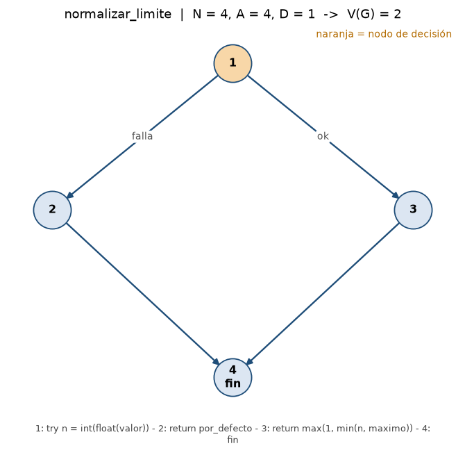
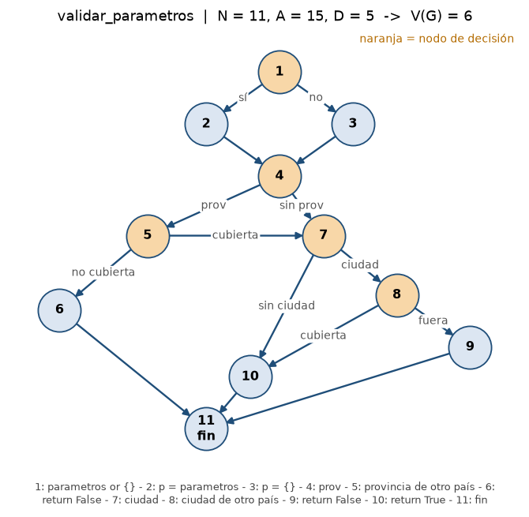
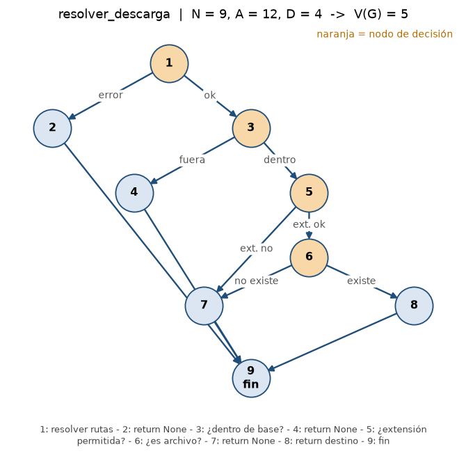

# Pruebas de caja blanca (camino básico)

La caja blanca diseña los casos mirando la **estructura del código**: se dibuja el grafo de flujo de la función, se calcula su
complejidad ciclomática V(G) y se arma **un caso de prueba por cada camino independiente**. Con eso se garantiza que cada sentencia
se ejecuta al menos una vez y que cada decisión se evalúa por verdadero y por falso.

**Funciones elegidas** (todas de `backend/diseno.py`): son las que protegen al sistema de entradas malas y cubren requisitos concretos.

| Función | Para qué sirve | Requisito / bug asociado |
|---|---|---|
| `normalizar_limite` | Acota la cantidad de resultados pedida por la IA | BUG-02 (inyección SQL por prompt) |
| `validar_parametros` | Rechaza consultas de otros países (cubre toda la Argentina) | HU-03 |
| `resolver_descarga` | Confina las descargas a una carpeta permitida | BUG-01 (lectura de `.env`) |

Cómo se calcula V(G) (las tres formas dan el mismo número): **V(G) = A − N + 2 = D + 1 = regiones**, donde A son las aristas,
N los nodos y D los nodos de decisión (cada condición simple cuenta; en `a and b` hay dos). Se agrega un nodo `fin` para que el
grafo tenga una sola salida. Los grafos se dibujan con `python scripts/generar_grafos_flujo.py`, que además **comprueba** esas igualdades.

## 1. `normalizar_limite` — V(G) = 2

```python
def normalizar_limite(valor, por_defecto=10, maximo=25):
    try:
        n = int(float(valor))                      # nodo 1 (decisión: ¿falla la conversión?)
    except (TypeError, ValueError):
        return por_defecto                          # nodo 2
    return max(1, min(n, maximo))                   # nodo 3   (nodo 4: fin)
```



N = 4, A = 4, D = 1 → V(G) = 4 − 4 + 2 = **2** = 1 + 1.

| Camino | Situación | Entrada | Esperado | Prueba |
|---|---|---|---|---|
| 1 – 3 – 4 | La conversión funciona | `"7"` | 7 | `test_tc048_camino_1_conversion_correcta` |
| 1 – 2 – 4 | La conversión falla | `"abc"`, `None` | 10 (valor por defecto) | `test_tc048_camino_2_falla_la_conversion` |

## 2. `validar_parametros` — V(G) = 6

```python
def validar_parametros(parametros):
    p = parametros or {}                                                  # nodos 1, 2, 3 (decisión 1)
    prov = normalizar(p.get("provincia"))                                 # nodo 4 (decisión 2: ¿hay provincia?)
    ciudad = normalizar(p.get("ciudad"))
    if prov and not any(x in prov for x in _PROVINCIAS_AR):               # nodo 5 (decisión 3)
        return False, MENSAJE_FUERA_COBERTURA                             # nodo 6
    if ciudad and any(ciudad == c or ciudad.startswith(c + " ") for c in _LUGARES_FUERA):   # nodos 7 y 8
        return False, MENSAJE_FUERA_COBERTURA                             # nodo 9
    return True, None                                                     # nodo 10   (nodo 11: fin)
```



N = 11, A = 15, D = 5 → V(G) = 15 − 11 + 2 = **6** = 5 + 1.

| Camino | Situación | Entrada | Esperado | Prueba |
|---|---|---|---|---|
| 1–3–4–7–10–11 | Sin parámetros | `None` | `(True, None)` | `test_tc049_camino_1_sin_parametros` |
| 1–2–4–5–6–11 | Provincia de otro país | `{"provincia": "Uruguay"}` | `False` | `test_tc049_camino_2_...` |
| 1–2–4–5–7–10–11 | Provincia cubierta, sin ciudad | `{"provincia": "Buenos Aires"}` (o `"Córdoba"`) | `(True, None)` | `test_tc049_camino_3_...` |
| 1–2–4–7–8–9–11 | Ciudad de otro país | `{"ciudad": "Montevideo"}` | `False` | `test_tc049_camino_4_...` |
| 1–2–4–7–8–10–11 | Ciudad cubierta (todo el país) | `{"ciudad": "Rosario"}` | `(True, None)` | `test_tc049_camino_5_...` |
| 1–2–4–5–7–8–9–11 | Provincia cubierta pero ciudad de otro país | `{"provincia": "Buenos Aires", "ciudad": "Montevideo"}` | `False` | `test_tc049_camino_6_...` |

## 3. `resolver_descarga` — V(G) = 5

```python
def resolver_descarga(base, ruta, permitidas=EXTENSIONES_DESCARGA):
    try:
        base_real = Path(base).resolve()                                  # nodo 1 (decisión: ¿error al resolver?)
        destino = (base_real / str(ruta)).resolve()
    except (OSError, ValueError):
        return None                                                       # nodo 2
    if not destino.is_relative_to(base_real):                             # nodo 3 (decisión)
        return None                                                       # nodo 4
    if destino.suffix.lower() not in permitidas or not destino.is_file(): # nodos 5 y 6 (decisiones)
        return None                                                       # nodo 7
    return destino                                                        # nodo 8   (nodo 9: fin)
```



N = 9, A = 12, D = 4 → V(G) = 12 − 9 + 2 = **5** = 4 + 1.

| Camino | Situación | Entrada | Esperado | Prueba |
|---|---|---|---|---|
| 1–2–9 | Error al resolver la ruta | (se fuerza un `OSError`) | `None` | `test_tc050_camino_1_...` |
| 1–3–4–9 | Sale de la carpeta permitida | `../secreto.csv` | `None` | `test_tc050_camino_2_...` |
| 1–3–5–7–9 | Extensión no permitida | `programa.exe` | `None` | `test_tc050_camino_3_...` |
| 1–3–5–6–7–9 | El archivo no existe | `no_existe.csv` | `None` | `test_tc050_camino_4_...` |
| 1–3–5–6–8–9 | Archivo válido | `datos.csv` | la ruta del archivo | `test_tc050_camino_5_...` |

## Verificación automática

- `tests/test_caja_blanca.py` ejecuta **un caso por camino** (14 pruebas) y comprueba además que la complejidad ciclomática calculada
  sobre el código real (`ast`) coincide con la de este documento: si alguien cambia una función, la prueba avisa que hay que actualizar el grafo.
- Cada camino se cubre con casos de caja negra distintos (ver `caja_negra.md`): se complementan, como indica la teoría.
- Se comprobó que las pruebas **pueden fallar**: ver `romper_a_proposito.md` (errores M1 a M4 en estas funciones).
